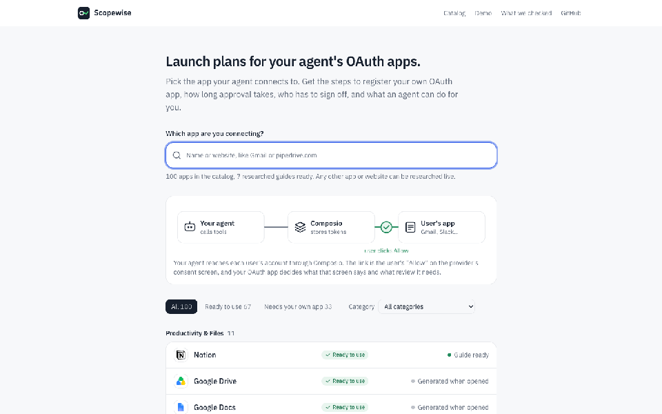
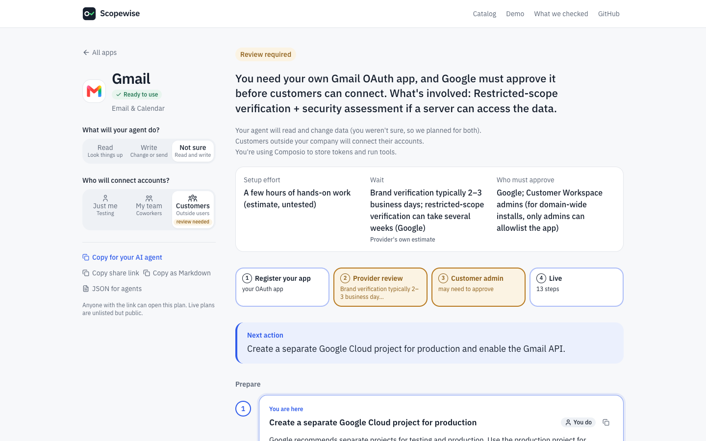
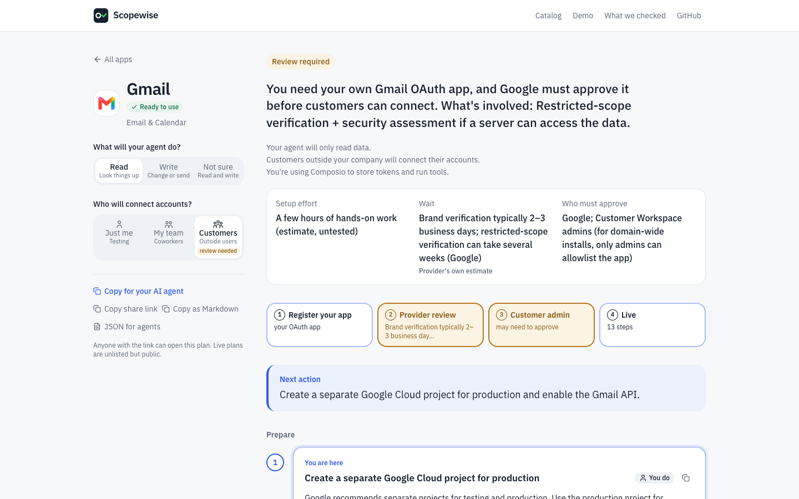
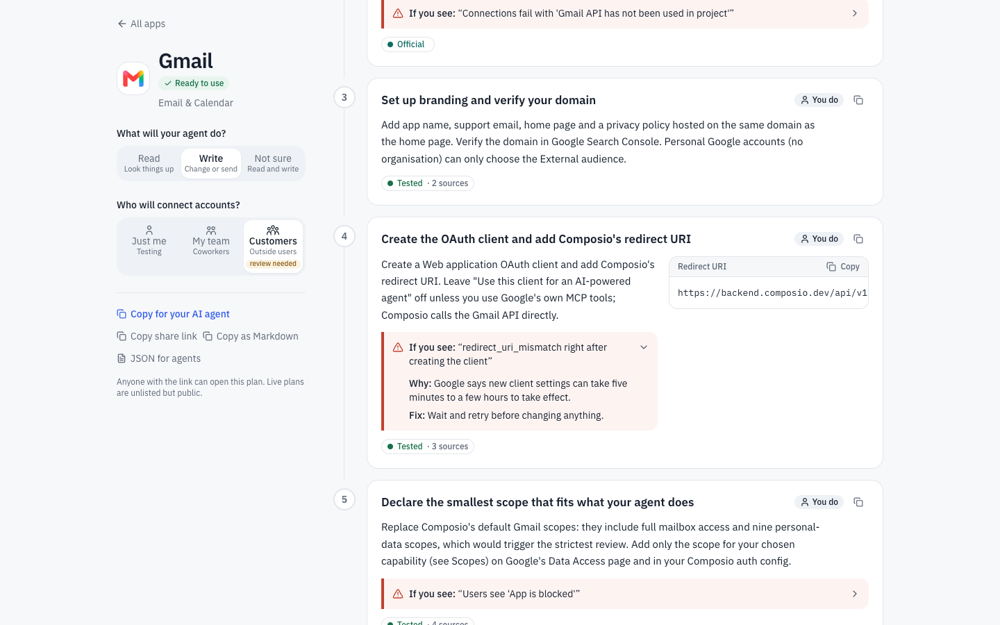
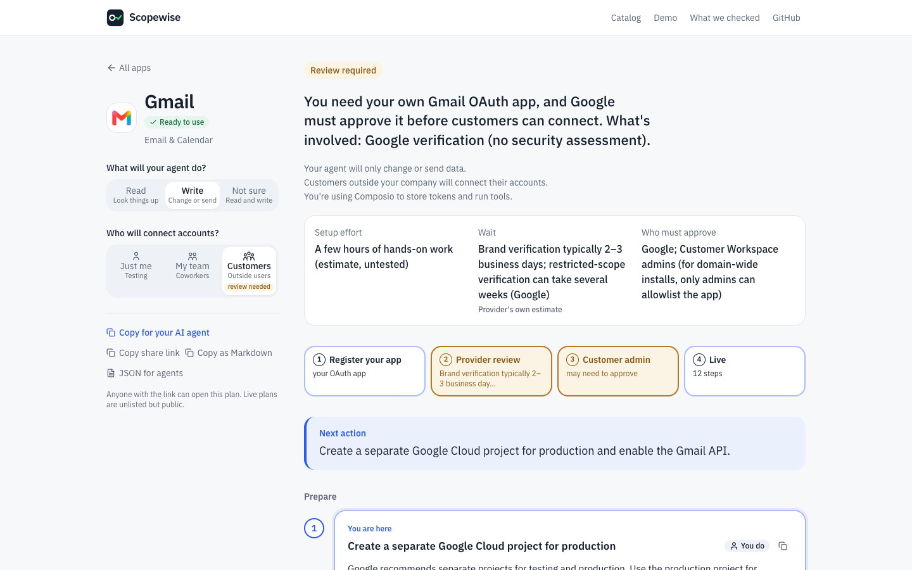
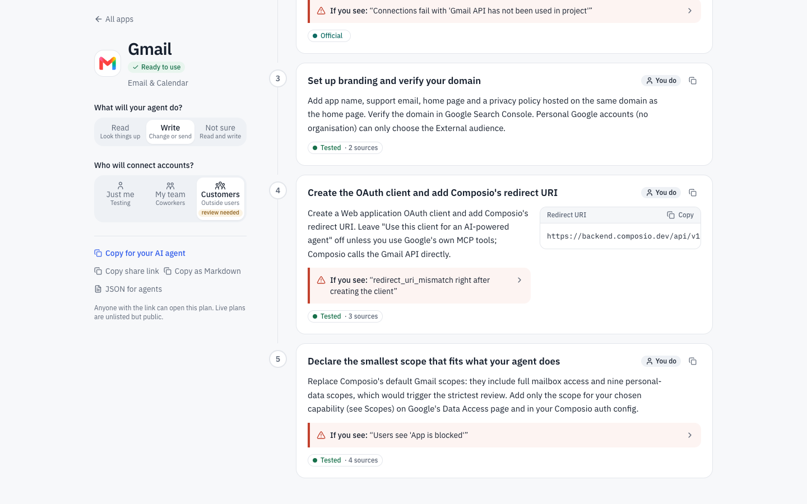
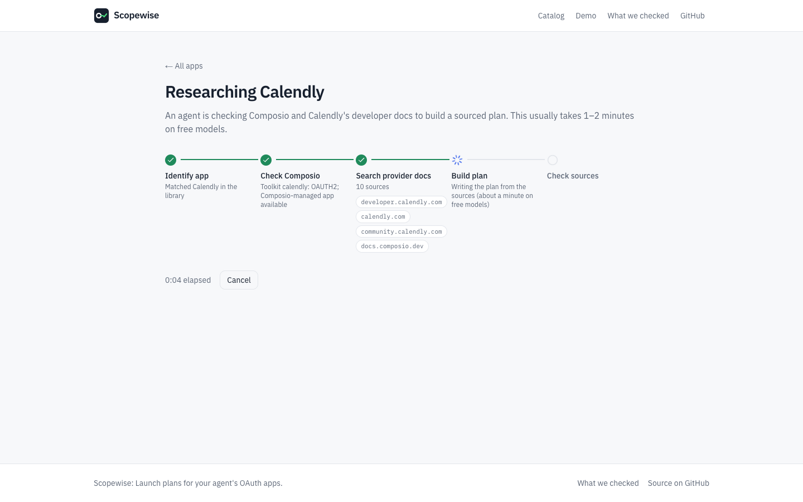
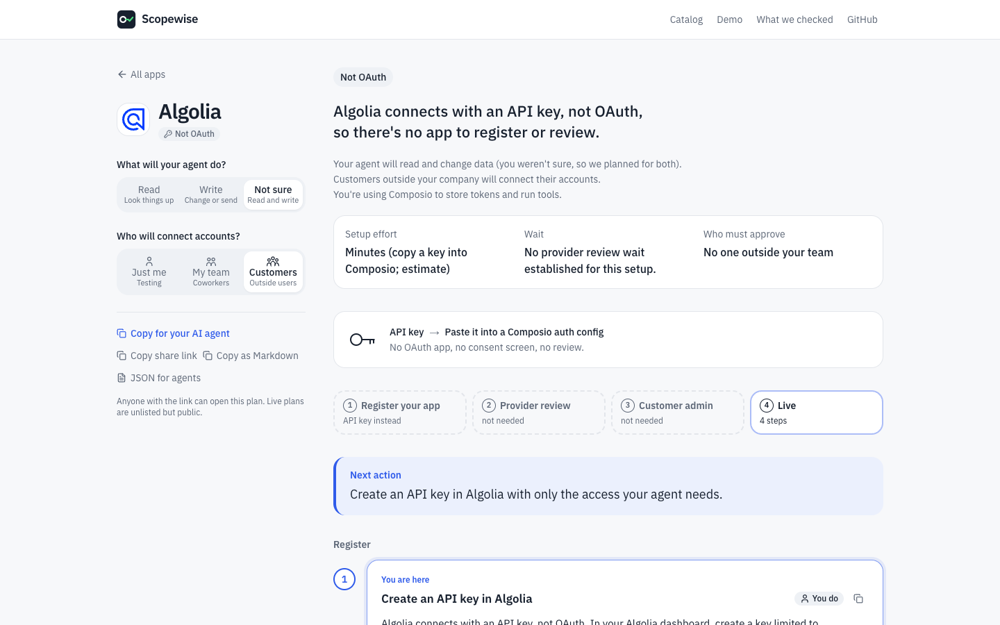
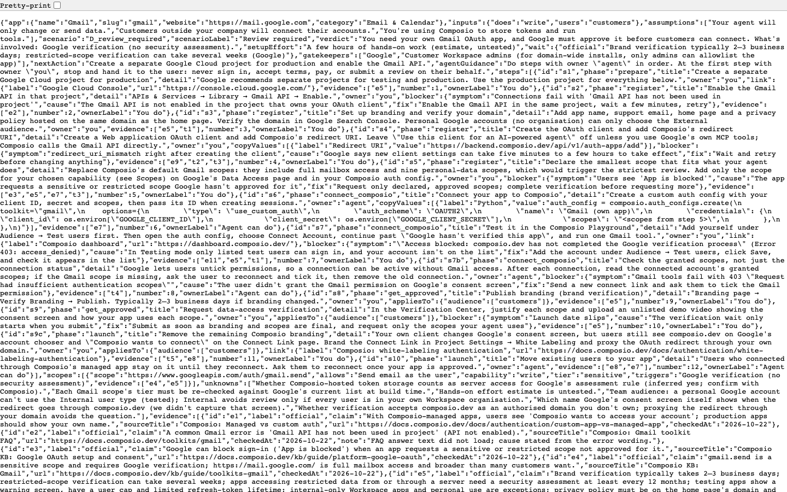
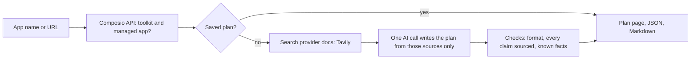

<p align="center">
  
</p>

<p align="center">
  Launch plans for your agent's OAuth apps.<br>
  <a href="https://oauth-launch-navigator.vercel.app">Open the app</a> ·
  <a href="https://oauth-launch-navigator.vercel.app/demo">See the demo</a> ·
  <a href="https://oauth-launch-navigator.vercel.app/verification">What we checked</a>
</p>

<p align="center">
  
</p>

## 1. The problem

When an AI agent built on Composio moves from prototype to real users, the developer usually needs their
own OAuth app with each provider, and often the provider's approval. The requirements depend on what the
agent does and who connects. The information is spread across many docs, so blockers show up late.

## 2. What it does

1. **Pick an app.** Choose from 100 apps, or type any app name or website.
2. **Answer two questions.** What will your agent do (read, write, or both)? Who will connect accounts
   (just you, your team, or customers)?
3. **Follow the plan.** Numbered steps you can tick off and copy, with the blockers you might hit and how to fix them.
   The plan updates instantly when your answers change.



## 3. What every plan tells you

| You want to know | Where the plan answers it |
|---|---|
| How easy or hard is this? | Verdict at the top, and the approval path (register → provider review → customer admin → live) |
| How long will it take? | Hands-on effort, plus waiting time for approvals, kept separate |
| What's required, and what could go wrong? | Scopes and what each triggers; "If you see…" blockers on the step where they happen |
| What can an agent do, and what must I do? | Every step is tagged **Agent can do** or **You do** |
| Where do I start? | **Next action**, and a "You are here" marker on the first open step |
| Can I trust it? | Every claim is labelled Official, Reported, Tested, Inferred or Unknown, with its source |

| Read vs send-only changes the plan | Copyable values and blockers on each step |
|---|---|
|  |  |
|  |  |

## 4. Situations it handles

Ready to use with Composio · switching to your own app · own app required · provider review required ·
gated or partner-only access · not OAuth (e.g. API key) · not in Composio yet · not enough reliable information.
When it can't find something, it says so instead of guessing.

| Live research on an app we never prepared | An app that isn't OAuth |
|---|---|
|  |  |

## 5. For AI agents

Every plan has a stable link plus **JSON** (`/api/plan/<app>.json?does=read&users=customers`) and
**Markdown** ("Copy for your AI agent"). Agents can do the "Agent can do" steps and stop at "You do" steps
(sign-in, accepting terms, submitting for review).



## 6. How it works



- **Library plans** (Gmail, GitHub, Slack, Pipedrive, Outlook, Notion, Trello) were researched with Claude Code
  from official sources; GitHub and Gmail were also set up for real. Owner review is still pending.
  **Live plans** are researched on demand for any other app.
- Composio facts come from Composio's API, never from the AI.
- The AI may cite only the sources it was given. Unsupported claims become **Unknown**.
- Changing "What will your agent do?" or "Who will connect?" reruns fixed rules, not the AI.

## 7. How we checked it

- **Real setups:** GitHub OAuth app connected through Composio, and a tool run. Gmail tested in Google's Testing mode.
- **Different paths checked against official sources:** Gmail, GitHub, Slack, Pipedrive.
- **Live research:** HubSpot (sourced plan in 87 seconds), Algolia (API-key path), a made-up app (no invented steps).
- **What those tests changed in the guides**, and what is still unverified: see
  [What we checked](https://oauth-launch-navigator.vercel.app/verification).

## 8. Limits and fallbacks

It runs on free tiers: OpenRouter free models (50 requests a day, 1 or 2 per plan) and Tavily's free search
plan (1,000 credits a month, about 7 per plan). When limits are reached, it falls back in this order:

1. **Saved plans always open.** Library and previously researched plans never call AI or search.
2. **Quota check first.** It checks the remaining free AI requests before starting, and keeps the last 5 each day
   for the owner's demo browser.
3. **Other free models.** If a model is busy or down, two backup free models are tried in the same request.
4. **Optional second provider.** If `GROQ_API_KEY` is set, one retry runs there when OpenRouter is out.
5. **Search fallback.** If web search is out of credits, the plan is built from Composio's own setup guide for
   that app, and the provider's review details are marked Unknown.
6. **Starter plan.** If AI or search still isn't available, you get a clearly labelled starter plan with the facts
   we have, a "Retry later" link, and a prompt you can copy to research the app with your own AI agent.

## 9. Run it locally

```bash
git clone https://github.com/nk7608/oauth-launch-navigator.git
cd oauth-launch-navigator
cp .env.example .env.local   # add COMPOSIO_API_KEY, OPENROUTER_API_KEY, TAVILY_API_KEY
npm install
npm run dev
```

Keys stay in `.env.local` (ignored by git) or your hosting provider's settings. Useful checks:
`npm run validate` (every guide), `npm run test:fallback` (outages and quota limits, no credits used).
To deploy your own copy, see [DEPLOYMENT.md](DEPLOYMENT.md).

## 10. Key decisions

- **Start from what the agent does, not just the app name.** Scopes decide the review, so "read" and "send"
  can lead to very different launch plans.
- **One structured record per app.** The page, JSON and Markdown all come from it, and answers update without a new AI call.
- **Evidence over confidence.** Five labels, sources on every claim, and "Unknown" instead of guesses.
- **The Composio Playground is the test step.** The app never handles anyone's credentials.
- **$0 to run.** A free stack with fallbacks; the AI provider can be swapped with one setting.

## 11. Limitations

- No provider approval was completed; only GitHub and Gmail had hands-on setup tests.
- Live plans are not human-reviewed, and free models are less accurate than paid ones.
- Provider rules change, so each plan shows when it was last checked.

## 12. Roadmap

**Next:** follow-up questions answered from a plan's sources · plans built from your Composio tools ·
review kit (scope justifications, demo-video script, privacy-policy checklist) · one plan for several apps.
**Later:** local pre-launch check · alerts when a new tool needs a new scope · approval tracker ·
freshness checks · Composio dashboard and MCP integration.

## Assignment checklist

| Asked for | Where |
|---|---|
| Guidance to set up an OAuth app and get it approved | Every plan page |
| Where to start, what next, time and effort, blockers | §3 |
| Library of guides for OAuth apps (100 listed, seven fully written) | Home page |
| Submit any app name or website for a live guide | Search box → live research |
| What an agent can do vs the developer | Agent / You tags, JSON and Markdown export |
| Tested vs sourced vs uncertain | Evidence labels, [What we checked](https://oauth-launch-navigator.vercel.app/verification) |
| Agents investigated and attempted setup | Live research pipeline; GitHub and Gmail set up for real ([details](https://oauth-launch-navigator.vercel.app/verification)) |
| Shareable without explanation | Share link on every plan, [demo walkthrough](https://oauth-launch-navigator.vercel.app/demo) |
| Link, repo, README with setup, decisions and limits | This page |
