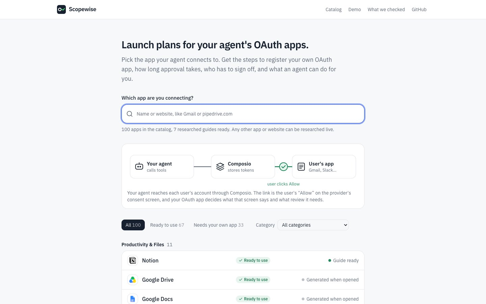
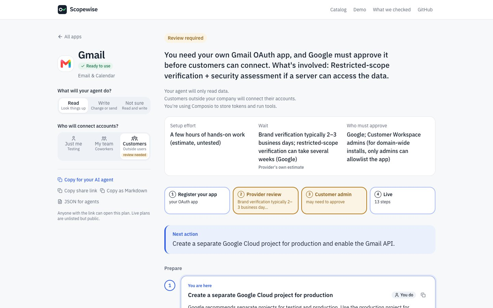
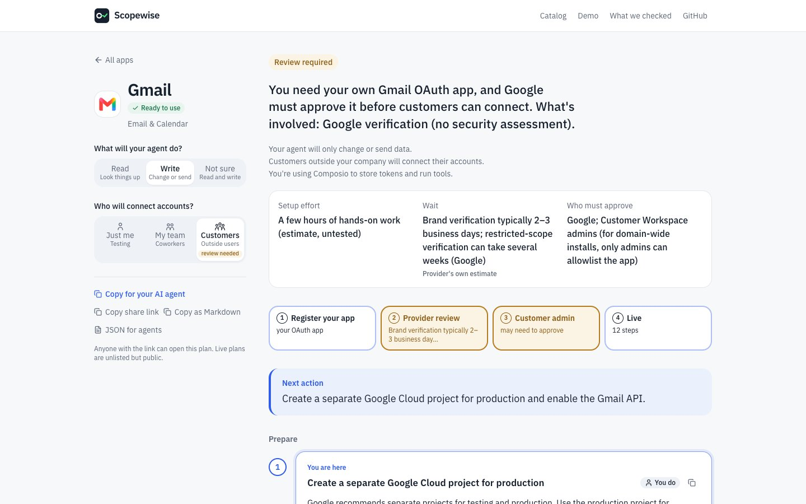
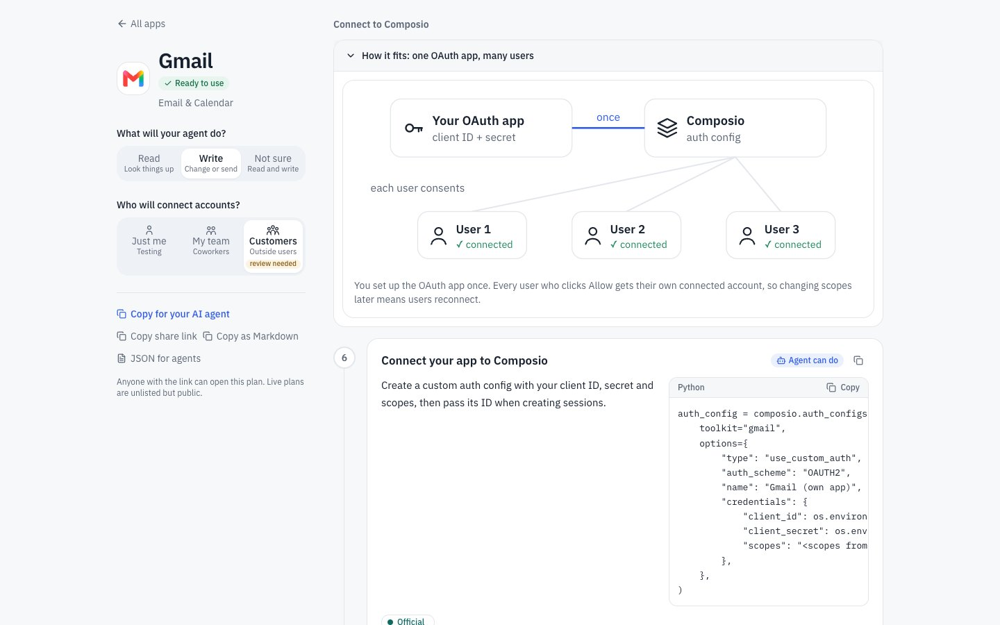
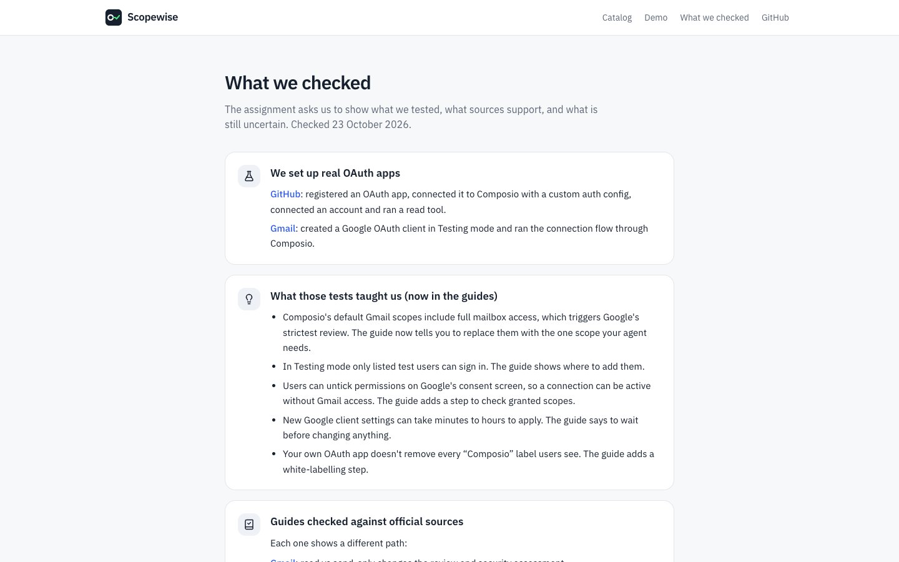
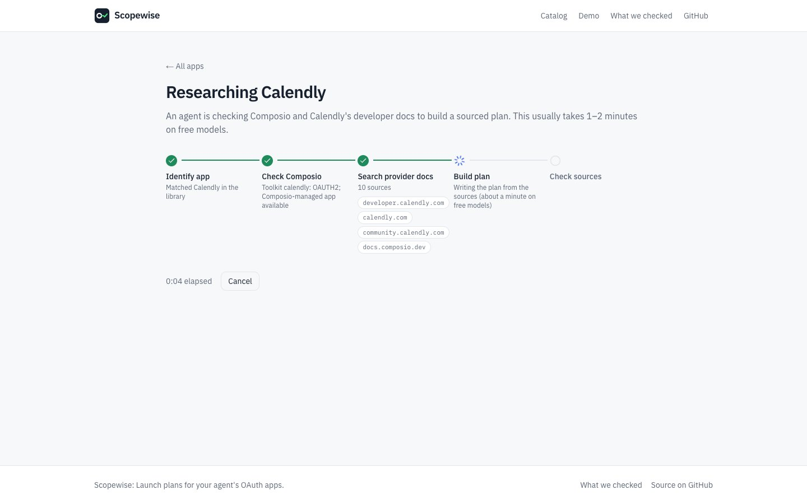
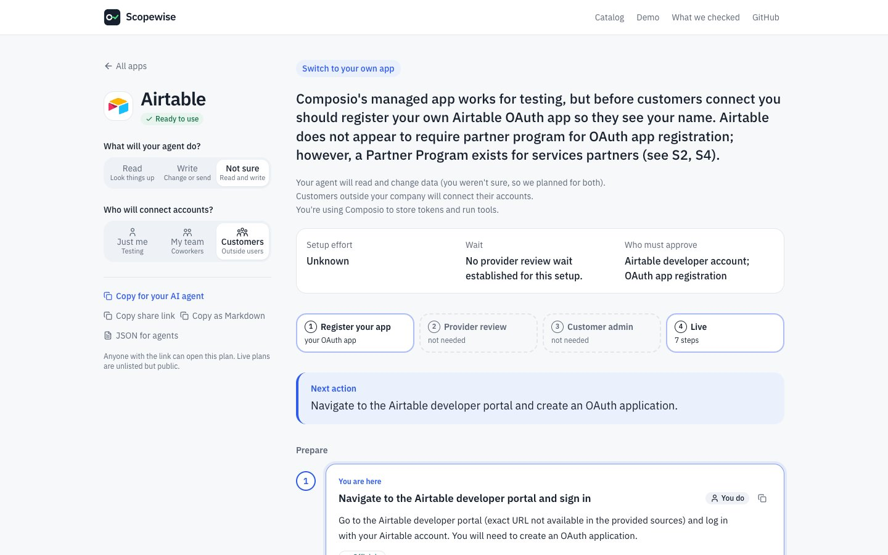
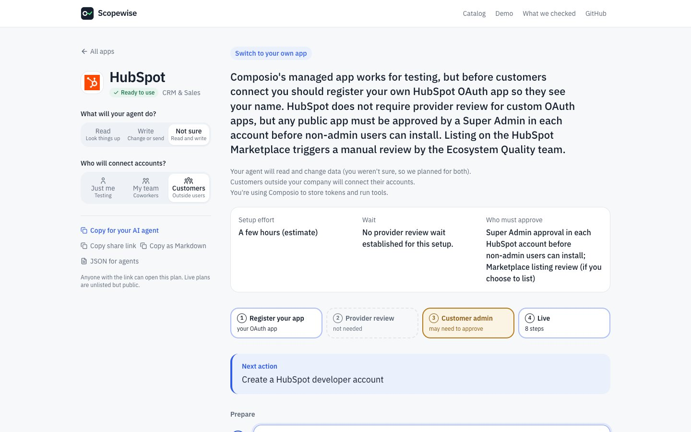

# Screenshot walkthrough

Real screens from the working app, captured on 23 October 2026. This independent assignment prototype researches setup requirements. It does not run visitors’ agents or connect their accounts. Gmail and GitHub account setup was attempted only as assignment testing.

[Try the app](https://oauth-launch-navigator.vercel.app/) · [Browse this walkthrough interactively](https://oauth-launch-navigator.vercel.app/demo)

The flow is: **find an app → choose access and audience → follow the next action → inspect evidence → share or research another app**.

## 1. Find the app you want to connect

Search by app name or website. Seven guides are ready; other apps can be researched live. This prototype gives setup guidance—it does not run your agent or connect your accounts.

[Open the catalog](https://oauth-launch-navigator.vercel.app/)

## 2. Choose access and audience

The same app can have different requirements. Gmail read access for customers includes restricted scopes. The guide shows the effort, wait, approvers and next action.

[Try Gmail read access](https://oauth-launch-navigator.vercel.app/plan/gmail?does=read&users=customers)

## 3. See what changes for send-only access

Switch to Write: the restricted-scope assessment step drops out for send-only access. Changing these choices uses rules, so it does not spend research credits.

[Compare send-only access](https://oauth-launch-navigator.vercel.app/plan/gmail?does=write&users=customers)

## 4. Follow the next action and hand off clearly

Steps identify what a person must do and what a coding agent can help with. The optional diagram sits beside the Composio configuration instructions and explains the setup a developer would perform outside this prototype.

[Open the connection steps](https://oauth-launch-navigator.vercel.app/plan/gmail?does=write&users=customers#phase-connect_composio)

## 5. Check the evidence before relying on a guide

Open the sources and unknowns. Tested means a dated observation from a setup attempt; it does not certify every scope or production approval. Most guides remain unreviewed.

[Read what was checked](https://oauth-launch-navigator.vercel.app/verification)

## 6. Research an app outside the catalog

A real Airtable run checked the toolkit and searched provider docs before writing and validating a guide. This is a captured live run, not an animation of a simulated result.

[Open the saved Airtable guide](https://oauth-launch-navigator.vercel.app/plan/airtable)

## 7. Get a saved, shareable result

That run saved seven steps with six sources and six open questions. It demonstrates generation and storage; Airtable account setup and approval have not been verified. Share links keep the selected choices, and JSON or Markdown exports support an agent handoff.

[Inspect the generated result](https://oauth-launch-navigator.vercel.app/plan/airtable)

## 8. Keep useful facts when research is limited

Before the retry, the hourly cap produced this labelled starter. It kept confirmed Composio facts and a source link while leaving provider requirements unknown. A later retry produced the guide above. Library and saved guides remain available.

[Open another saved live guide](https://oauth-launch-navigator.vercel.app/plan/hubspot)

## Scope of the screenshots

The live-progress image and limited-research image are separate captures from real public requests. The limited state happened before the successful retry; it is not the current Airtable result. The other screenshots show the completed UI. None is a mockup or a claim that provider approval was completed.

For API-key and unknown-app examples, open [Algolia](https://oauth-launch-navigator.vercel.app/plan/algolia) and [the fictional-app result](https://oauth-launch-navigator.vercel.app/plan/zorblat-crm). For another OAuth path, open the [GitHub guide](https://oauth-launch-navigator.vercel.app/plan/github).
